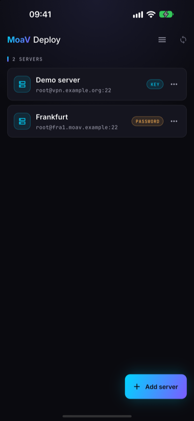
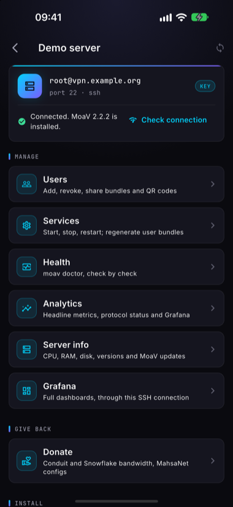
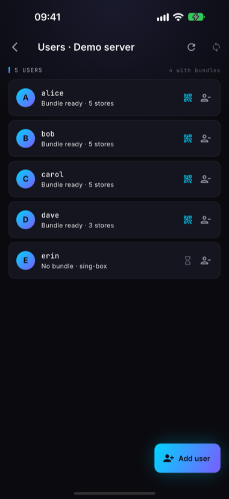
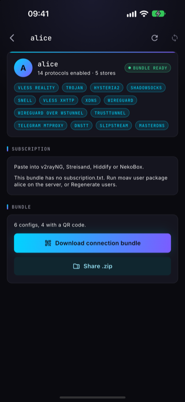
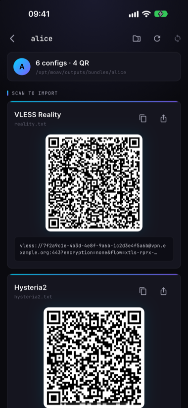
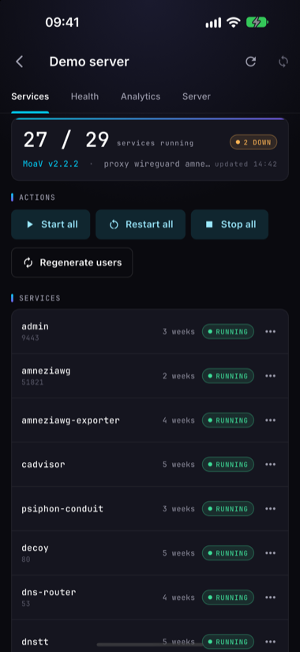
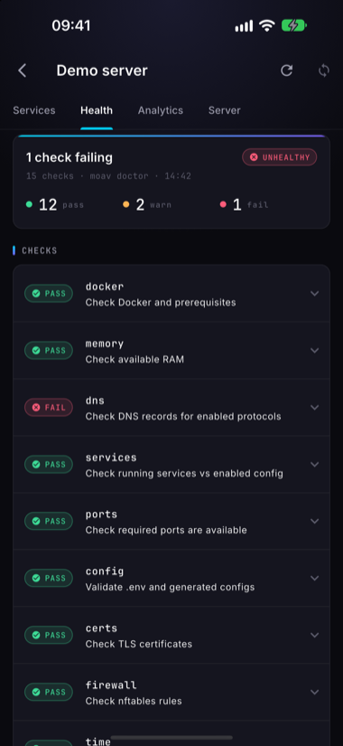
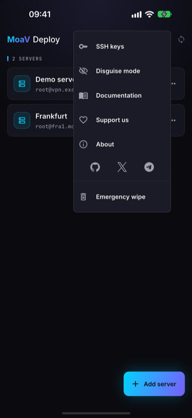

2026-10-29 · Release · 5 min read · <a href="../../">The MoaV Blog</a>

# MoaV Deploy mobile app is in public beta

**MoaV Deploy is now in public beta on Android and iOS.** It is a phone app that installs and manages your own MoaV server over SSH. Point it at a fresh VPS, tap deploy, add a user, hand them a QR code. No laptop in the loop.

One thing to be clear about before anything else: this is a server administration app, not a VPN client. It never routes your phone's traffic. To connect to the server it builds, you use the [client apps](https://moav.sh/docs/CLIENTS/) you already know, with the bundle this app hands out.

- **Android:** [Google Play (open testing)](https://play.google.com/store/apps/details?id=org.motherofallvpns.moavdeploy)
- **iOS:** [TestFlight](https://testflight.apple.com/join/7S972Bwk)
- **Sideload:** signed APK and AAB on [GitHub Releases](https://github.com/MotherofallVPNs/moav-deploy-app/releases)
- **Source:** [MotherofallVPNs/moav-deploy-app](https://github.com/MotherofallVPNs/moav-deploy-app)
- **Docs:** [moav.sh/docs/deploy](https://moav.sh/docs/deploy/)

## Why a phone app

MoaV's whole bet is that a censorship-free internet comes from thousands of people each running a server, not from one more client app. The one-line installer got that down to a terminal and ten minutes. But a terminal is still a wall for many of the people we most want running servers: the cousin who is good with phones, the friend abroad who has never opened SSH, the operator who is on a bus when a user's bundle stops working.

MoaV Deploy takes the wall down. Everything you do with a MoaV server in a normal week fits on a phone screen, and the phone is the computer people already carry.

## What it does

The app drives the `moav` CLI on your server over SSH. Nothing new runs on the server. The app is a remote control for what is already there.

- **One-tap deploy to a fresh VPS.** Add the server by IP, give it the root password or an SSH key, and tap Install. The install runs detached on the server, so you can close the app and come back; it reattaches to the running job. No domain yet? It installs in domainless mode and turns on everything that does not need a certificate.
- **16+ protocols.** Reality, Hysteria2, WireGuard, AmneziaWG, Shadowsocks and the rest of the MoaV stack, with the same automatic fallback you get from a terminal install.
- **Users and bundles.** Add and remove users. Open one and the app pulls their bundle from the server and shows every connection link as a QR code, or shares the whole thing as a .zip through any app on your phone.
- **Live status and health.** How many services are running, start, restart or stop them one at a time or all at once, and `moav doctor` results with each check marked pass, warn or fail.
- **Embedded Grafana.** The server's monitoring dashboards, inside the app.
- **Non-interactive server updates.** Update MoaV from the app, with no prompts to answer and no terminal to babysit.

<figure markdown="span">
{ loading=lazy }
<figcaption>Your servers</figcaption>
</figure>
<figure markdown="span">
{ loading=lazy }
<figcaption>One server, one screen</figcaption>
</figure>
<figure markdown="span">
{ loading=lazy }
<figcaption>Users and bundle status</figcaption>
</figure>
<figure markdown="span">
{ loading=lazy }
<figcaption>Bundle as QR or .zip</figcaption>
</figure>
<figure markdown="span">
{ loading=lazy }
<figcaption>Scan to connect</figcaption>
</figure>
<figure markdown="span">
{ loading=lazy }
<figcaption>Live service status</figcaption>
</figure>
<figure markdown="span">
{ loading=lazy }
<figcaption>moav doctor, on a phone</figcaption>
</figure>
<figure markdown="span">
{ loading=lazy }
<figcaption>Keys, disguise, wipe</figcaption>
</figure>

## Private by design

Some of the people this app is for are people for whom a phone search is a real risk. The defaults are set for them.

- **No accounts, no ads, no tracking.** There is no backend. The app talks to your server over SSH and to nothing else. No analytics, no telemetry. The [privacy policy](https://moav.sh/docs/deploy/privacy/) is short because there is nothing to disclose.
- **Keys stay on the device.** SSH keys, hosts and passwords live in the Keychain on iOS and the Keystore on Android. They leave the phone only inside the SSH session you start.
- **Biometric app lock.** Face, fingerprint or passcode before the app opens.
- **Disguise mode, optional.** The app presents itself as a plain notes app until a secret gesture and passcode reveal it. An emergency wipe clears every stored server and key in one action.

## Get it

[Google Play](https://play.google.com/store/apps/details?id=org.motherofallvpns.moavdeploy) and [TestFlight](https://testflight.apple.com/join/7S972Bwk) are the easy routes. If you would rather not go through a store, every release on [GitHub Releases](https://github.com/MotherofallVPNs/moav-deploy-app/releases) carries a signed APK and AAB next to a `SHA256SUMS` file. Check the hash before you install. Once it is running, the About screen shows the app's signing fingerprint, so you can confirm a sideloaded build is signed with our key and not somebody else's.

## Test it, break it, tell us

This is a beta, and the networks it has to work on are the hard ones. We have run it against our own servers and in CI. What we cannot reproduce is your ISP, your VPS provider's SSH quirks, and your phone.

1. **Install the beta** and point it at a throwaway VPS. Run a full install from the app, then add a user and connect a client with the QR code.
2. **Use it on a real network.** Mobile data, a censored home connection, a VPS in a region we have not tried. Did the SSH session hold? Did the detached install reattach when you came back?
3. **Report what broke.** Open an issue on [GitHub](https://github.com/MotherofallVPNs/moav-deploy-app/issues) with the app version from the About screen, your phone and OS version, and what the server said. iOS testers can also send it through TestFlight feedback.

Feature requests are welcome in the same [issue tracker](https://github.com/MotherofallVPNs/moav-deploy-app/issues). On our side, the loose list for after the beta is a fleet view across several servers, a native control API so the app no longer has to go through the CLI, and wider distribution, F-Droid among the options. No dates. The beta comes first.

Install it. Then tell us what you see.
